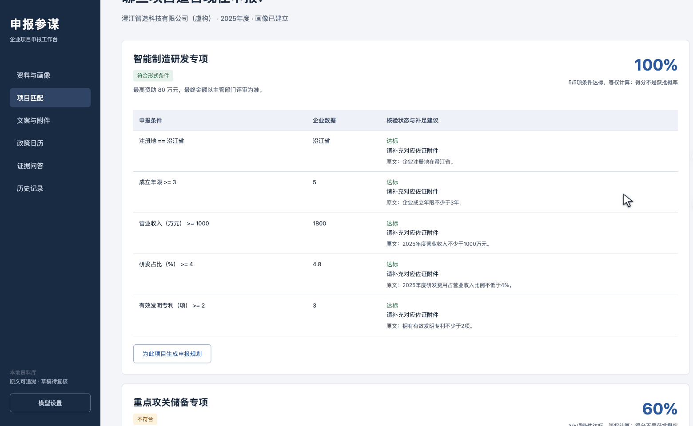

# 申报参谋

申报资料解析与文案生成智能体比赛交付。导入政策和企业档案，使用真实 DeepSeek Agent 工具调用解析政策，再由确定性程序逐条件核验资格、计算数值差距，检索原文生成不少于1000字的申报前置规划与申报书草稿。



[下载完整比赛交付与演示视频](https://github.com/ShanHuiSir/application-advisor-agent/releases/latest)

## 运行

推荐下载 Releases 中的 Windows 免安装版，解压至可写目录，双击 `启动申报参谋.bat`。原生 Windows 管理窗口负责本地服务及提醒生命周期，业务工作台在默认浏览器打开。保持桌面管理窗口运行即可每分钟检查一次政策节点。

源码运行需 Python 3.11 或更新版本：

```bash
python -m venv .venv
# Windows: .venv\Scripts\activate
# macOS/Linux: source .venv/bin/activate
python -m pip install -r requirements.txt
python app.py
```

打开 http://127.0.0.1:8891 。Windows 源码也可运行 `启动申报参谋.bat`（首次需安装依赖），或 `python desktop_native.py`。工作台“模型设置”输入自己的 DeepSeek Key；可选择保存在本机 `.env`。调用真实模型需要联网及可用配额。未配置或调用失败会明确报错，不使用预制结果兜底。

## 功能

- TXT/MD/JSON/DOCX/文字型PDF输入，最长12万字符。扫描件需先OCR。
- 多项目申报条件、资金上限、网报/纸质截止日期和附件提取，逐条引用原文。
- 企业注册地、成立年限、资产、营业收入、人员、研发占比、有效发明专利画像。
- 等权条件得分、硬资格结论、未知条件标记、数值差距和补足建议。
- 本地分块索引与中文双字召回，带分块引用的证据问答和申报文案。
- Word申报书草稿、Markdown规划、CSV附件清单、ICS日历、JSON运行证据整包导出。
- 北京时间政策日历，7/3/1天窗口提醒，本地持久化历史记录。

## 验收与范围

`samples` 是明确虚构的省级指南和企业档案。真实模型验收、视频实测与最终交付在 `docs` 及 Releases，得分不是获批概率。最终版官方申报书必须由企业确认预算、成果目标、签章和官方格式；本应用生成可编辑草稿，不声称已得到主管部门审核。

`python -m unittest discover -s tests -v` 可离线运行核心规则测试。`python scripts/live_acceptance.py` 需自己的Key，复现真实模型验收。Windows原生入口和嵌入式运行时由GitHub Actions核验；完整用户桌面体验仍需实际Windows人工验收。

比赛材料的2026年5月31日时效加分截止日已过，本项目按2026年10月实际交付，不主张该项加分。移动端/微信接口仅提供扩展设计，未接入外部通知。

## 文档

- [部署说明](docs/本地部署与操作手册.md)
- [知识库与工作流](docs/知识库索引与Agent工作流.md)
- [要求对应](docs/需求与验收对应.md)
- [已验证能力](docs/版本与验证范围.md)

## 许可与数据

工程源码采用MIT许可。依赖保留各自许可证。资料保存在本机 `runtime/advisor.sqlite`，选定政策与企业内容会发给DeepSeek推理。公开示例仅包含模拟数据，Key不随仓库或整包交付。
